# Thirty Cities, One Forecast

*Five cities. Five data formats. One prediction.*

[Pipeline Architecture · Hard · on DataDriven](https://datadriven.io/problems/thirty_cities_one_forecast)

## How it went

| | |
|---|---|
| Solved | 2026-10-21 |
| Accepted | on the 3rd submission |
| Hints | 2 hints |
| Concepts | Backfill Patterns, Batch Processing, DAG Orchestration, Data Lake Architecture, Data Quality & Validation, Dependency Management, ELT vs ETL, File-Based Ingestion, Full vs Incremental Load, Idempotency, Pipeline Monitoring, Partitioning Strategies, Retry & Failure Handling, Schema Evolution |

## The design

```mermaid
flowchart LR
    n1[("<b>Source</b><br/>raw data 42 cities")]
    n2[/"<b>Queue</b><br/>streaming data for 42 cities"/]
    n3["<b>Transform</b><br/>transform"]
    n4[("<b>Source</b><br/>Transformed data in DWH")]
    n5[("<b>Storage</b><br/>3 years historical features")]
    n6{{"<b>Quality</b><br/>Readiness gate"}}
    n7[/"<b>Queue</b><br/>Backfill queue"/]
    n1 --> n2
    n2 --> n3
    n3 --> n4
    n5 --> n1
    n4 --> n6
    n6 --> n2
    n7 --> n5
    classDef source fill:#1B3D2E,stroke:#34D399,color:#34D399
    classDef transform fill:#1E3A5F,stroke:#5B8DEF,color:#5B8DEF
    classDef storage fill:#2A2348,stroke:#A78BFA,color:#A78BFA
    classDef quality_gate fill:#3A3020,stroke:#FBBF24,color:#FBBF24
    classDef queue fill:#1A3A40,stroke:#22D3EE,color:#22D3EE
    class n1,n4 source
    class n3 transform
    class n5 storage
    class n6 quality_gate
    class n2,n7 queue
    linkStyle 0 stroke:#3B82F6
    linkStyle 1 stroke:#3B82F6
    linkStyle 2 stroke:#3B82F6
    linkStyle 3 stroke:#3B82F6
    linkStyle 4 stroke:#3B82F6
    linkStyle 5 stroke:#3B82F6
    linkStyle 6 stroke:#3B82F6
```

The whole design, with every component's settings, the connections, the zones and where each sits on the canvas, is in [`architecture.json`](./architecture.json).
